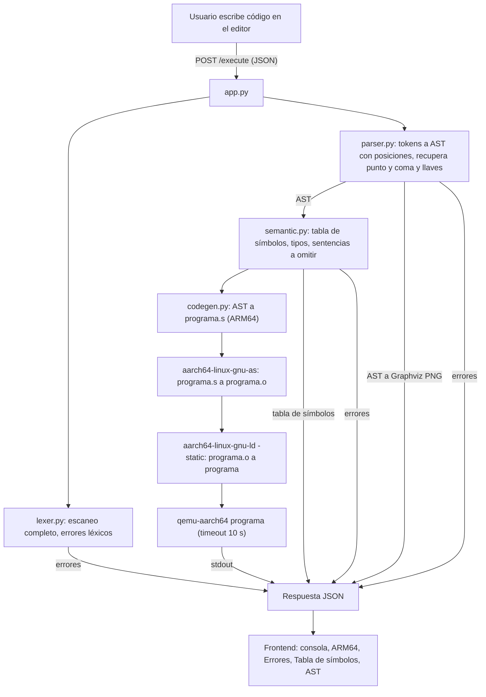
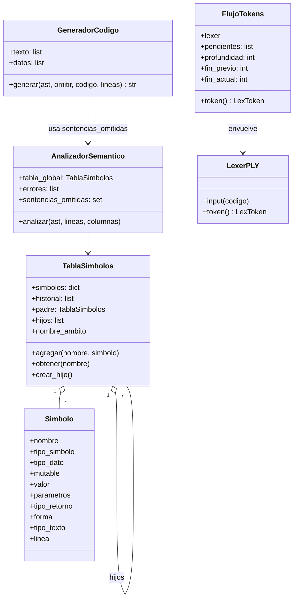

# Documentación Técnica — OxigenNative

## 1. Introducción

Este documento describe la implementación del **compilador de OxigenNative**, un lenguaje de tipado estático con sintaxis inspirada en Rust. El compilador traduce el programa fuente **directamente a ensamblador ARM64 (AArch64)**, sin representación intermedia de tres direcciones. Luego lo ensambla, lo enlaza y lo ejecuta con **QEMU User Mode** dentro del servidor Linux.

El proyecto parte del intérprete del Proyecto 1 (OxigenScript). El análisis léxico, sintáctico y semántico se reutilizó y se amplió. La fase de ejecución por recorrido del árbol se reemplazó por el generador de código ARM64 (`codegen.py`).

### 1.1. Tecnologías utilizadas

| Componente | Tecnología |
|---|---|
| Lenguaje de implementación | Python 3 |
| Análisis léxico y sintáctico | PLY 3.11 (Python Lex-Yacc, parser LALR(1)) |
| API REST | Flask + flask-cors |
| Interfaz gráfica | React 19 + Vite |
| Reporte de AST | Graphviz (formato DOT → PNG) |
| Ensamblador y enlazador | GNU binutils `aarch64-linux-gnu-as` / `aarch64-linux-gnu-ld` |
| Ejecución | `qemu-aarch64` (QEMU User Mode) |
| Sistema operativo | Linux |

---

## 2. Arquitectura de la aplicación

La aplicación es un **monolito cliente/servidor** con cuatro componentes:

1. **Capa de presentación (frontend React):** editor de código, panel con el código ARM64 generado, consola de salida y panel de reportes (Errores, Tabla de símbolos, AST).
2. **Capa de lógica y servicios (API REST en Flask):** recibe el código fuente y coordina el pipeline de compilación.
3. **Definición del lenguaje (PLY):** reglas léxicas (`lexer.py`) y sintácticas (`parser.py`).
4. **Entorno de simulación ARM64:** `as` + `ld` + `qemu-aarch64`, invocados desde `app.py`.

### 2.1. Módulos del backend

| Módulo | Responsabilidad |
|---|---|
| `lexer.py` | **Análisis léxico.** Convierte el código en tokens. Detecta caracteres no reconocidos y comentarios de bloque sin cerrar en una pasada completa e independiente del archivo. |
| `parser.py` | **Análisis sintáctico LALR(1).** Construye el AST con tuplas de Python. Registra la línea y columna de cada nodo para los mensajes de error. Recupera errores insertando el `;` o la `}` faltantes. |
| `semantic.py` | **Análisis semántico.** Tabla de símbolos con ámbitos anidados, verificación de tipos según las tablas del enunciado, mutabilidad, sombreado, número de argumentos y límites de arreglos con índice literal. Marca las sentencias con error fatal para que el generador no las emita. |
| `codegen.py` | **Generación de código ARM64.** Recorre el AST y emite directamente instrucciones AArch64 (sección `.text`), literales (`.data`) y el heap (`.bss`). Agrega solo las rutinas de la biblioteca de tiempo de ejecución que el programa usa. |
| `app.py` | Endpoint `POST /execute`. Ejecuta todo el pipeline, ensambla, enlaza y ejecuta con QEMU. Unifica y ordena los errores y arma la tabla de símbolos y el AST para el frontend. |
| `ast_generator.py` | Convierte la lista aplanada de nodos del AST en un grafo Graphviz y lo devuelve como PNG en base64. |
| `interpreter.py` | Intérprete del Proyecto 1. Ya no forma parte del pipeline, se conserva como referencia y lo usan algunas pruebas antiguas. |

### 2.2. Flujo de compilación y ejecución



La respuesta de `/execute` tiene esta forma:

```json
{
  "errores":      [{"tipo": "Semantico", "linea": 7, "columna": 24, "mensaje": "...", "formato": "[Error Semántico] Línea 7, Columna 24\n..."}],
  "salida":       ["línea 1 de stdout", "línea 2"],
  "symbols":      [{"no": 1, "nombre": "x", "categoria": "Variable", "tipo": "i32", "ambito": "main", "linea": 3, "valor": "10"}],
  "ast":          [{"label": "Programa", "depth": 0}],
  "ast_image":    "<PNG en base64>",
  "codigo_arm64": "<archivo .s completo>",
  "tiempo":       "0.0021s"
}
```

### 2.3. Diagrama de clases



---

## 3. Gramática formal de OxigenNative

La gramática implementada en `parser.py` se muestra en notación BNF simplificada. Las palabras entre comillas son tokens literales. `ID`, `INTEGER`, `FLOAT`, `STRING`, `CHAR_LITERAL` y `LABEL` son tokens del lexer.

```bnf
programa          ::= declaracion+
declaracion       ::= funcion | struct_decl

funcion           ::= "fn" ID "(" lista_parametros ")" ( "->" tipo )? "{" sentencia* "}"
lista_parametros  ::= ( parametro ( "," parametro )* )?
parametro         ::= ID ":" tipo

struct_decl       ::= "struct" ID "{" ( ID ":" tipo ","? )+ "}"

tipo              ::= "i32" | "f64" | "bool" | "char" | "String" | ID
                    | "[" tipo ";" INTEGER "]"                (* recursivo: [[i32; 3]; 2] *)

sentencia         ::= declaracion_let
                    | asignacion
                    | sentencia_if | sentencia_while | sentencia_loop | sentencia_match
                    | sentencia_return | sentencia_break | sentencia_continue
                    | "{" sentencia* "}"                       (* bloque con ámbito propio *)
                    | expresion ";"
                    | error ";" | error "}"                    (* recuperación de PLY *)

declaracion_let   ::= "let" "mut"? ID ":" tipo "=" valor ";"
                    | "let" "mut"? ID "=" valor ";"
                    | "let" "mut"? ID ":" tipo ";"             (* valor por defecto del tipo *)

asignacion        ::= ID op_asignacion valor ";"
                    | expresion "[" expresion "]" op_asignacion valor ";"
                    | expresion "." ID op_asignacion valor ";"
op_asignacion     ::= "=" | "+=" | "-=" | "*=" | "/=" | "%="
                    (* x op= e se transforma en el AST a x = x op e *)

sentencia_if      ::= "if" expresion "{" sentencia* "}"
                      ( "else" ( "{" sentencia* "}" | sentencia_if ) )?
sentencia_while   ::= "while" expresion "{" sentencia* "}"
sentencia_loop    ::= ( LABEL ":" )? "loop" "{" sentencia* "}"
sentencia_match   ::= "match" expresion "{" caso_match+ "}"
caso_match        ::= patron "=>" ( expresion | "{" sentencia* "}" ) ","?
patron            ::= INTEGER | "-" INTEGER | CHAR_LITERAL | "true" | "false" | "_" | ID

sentencia_return  ::= "return" valor? ";"
sentencia_break   ::= "break" LABEL? ";"
sentencia_continue::= "continue" LABEL? ";"

valor             ::= expresion | ID "{" ( ID ":" valor "," )* ID ":" valor ","? "}"

expresion         ::= expresion op_binario expresion
                    | "-" expresion | "!" expresion
                    | INTEGER | FLOAT | STRING | CHAR_LITERAL | "true" | "false" | ID
                    | "(" expresion ")"
                    | ID "(" argumentos ")"                          (* llamada a función *)
                    | "println" "!" "(" argumentos ")"
                    | expresion "." ID "(" argumentos ")"            (* método: s.len(), a.reverse() *)
                    | expresion "." ID                               (* campo de struct *)
                    | "String" "::" ID "(" argumentos ")"            (* String::from / String::new *)
                    | "[" ( valor ( "," valor )* )? "]"              (* arreglo literal *)
                    | "[" expresion ";" INTEGER "]"                  (* arreglo repetido *)
                    | expresion "[" expresion "]"                    (* acceso, encadenable: m[i][j] *)
                    | "&" expresion "[" expresion ".." expresion "]" (* slice *)
argumentos        ::= ( valor ( "," valor )* )?

op_binario        ::= "||" | "&&" | "==" | "!=" | ">" | ">=" | "<" | "<="
                    | "+" | "-" | "*" | "/" | "%"
```

**Precedencia** (de menor a mayor, todas asociativas por la izquierda salvo los unarios):
`||` → `&&` → `==` `!=` → `>` `>=` `<` `<=` → `+` `-` → `*` `/` `%` → `!` `-` unario (derecha) → `.` `[]`.

### 3.1. Léxico

| Token | Patrón / ejemplo |
|---|---|
| `ID` | `[a-zA-Z_][a-zA-Z0-9_]*`, sensible a mayúsculas, excepto palabras reservadas |
| `INTEGER` / `FLOAT` | `\d+` / `\d+\.\d+` (por eso `1..4` se lee como `1`, `..`, `4`) |
| `STRING` | `"..."` con escapes `\n \t \r \" \\ \0`; raw strings `r"..."` y `r#"..."#` sin escapes |
| `CHAR_LITERAL` | `'a'`, `'\n'` |
| `LABEL` | `'externo` (etiqueta de `loop`), se define después de `CHAR_LITERAL` |
| Comentarios | `// ...` y `/* ... */` (descartados); `/*` sin cierre → error léxico |

### 3.2. Diferencias y ambigüedades resueltas respecto al enunciado

1. **`=>` y `->`** son tokens distintos (`FLECHA_GORDA` y `FLECHA`).
2. **`println!`** se modela como el token `PRINTLN` seguido de `!`, porque `!` también es la negación lógica.
3. **Etiquetas de `loop` frente a literales de carácter:** ambos empiezan con `'`. El literal exige la comilla de cierre y se declara primero en el lexer.
4. **`::`** existe solo para `String::from(...)` y `String::new()`.
5. **`match`:** la coma es opcional en el último caso y después de un bloque, como en Rust. Los patrones aceptan enteros (también negativos), caracteres, booleanos y el comodín `_`.
6. **`x += e`** y los demás operadores compuestos se convierten en el parser a `x = x + e`. Así el generador solo maneja la asignación simple.
7. **Métodos (`v.len()`, `s.replace(a, b)`):** se convierten a una llamada `len(v)` o `replace(s, a, b)`, con el receptor como primer argumento.

---

## 4. Generación de código ARM64

### 4.1. Estructura del archivo `.s` generado

```text
# Código ARM64 (AArch64) generado por el compilador de OxigenNative
.section .data          literales de texto (strN: .ascii "..."), buffers, "true"/"false"
.section .text
.global _start
_start:                 bl main ; exit(0) con la syscall 93
<una etiqueta por cada función del programa>
<biblioteca de tiempo de ejecución: solo las rutinas usadas>
.section .bss           heap_base: .skip 33554432   (solo si el programa usa el heap)
```

El código usa la sintaxis de GNU `as`. El generador comenta:

- El inicio de cada función (firma y tamaño del stack frame)
- El prólogo y el epílogo
- La ubicación de cada variable (`# variable "x" (i32) en [x29, #-16]`)
- Cada sentencia del programa fuente (`# [linea 14] let s: i32 = sumar(2, 3);`)
- Cada rutina de la biblioteca, con sus registros de entrada y salida.

### 4.2. Modelo de memoria

**Stack:** Cada función tiene un stack frame fijo calculado en tiempo de compilación:

```text
direcciones altas
    [x29 + 8]   x30 (link register) guardado
    [x29]       x29 anterior (frame pointer del llamador)   <- x29
    [x29 - 16]  primera variable / parámetro (slot de 16 bytes)
    [x29 - 32]  segunda variable
    ...         arreglos: N*8 bytes redondeados a múltiplo de 16
    [x29 - E]                                               <- sp tras el prólogo
    ...         temporales de expresiones (push/pop de 16 bytes)
direcciones bajas
```

- Antes de generar el cuerpo, `_reservar_variables` recorre la función completa, incluidos `if`, `while`, `loop`, `match` y bloques `{}`. Asigna **un slot propio a cada `let` y a cada parámetro**, identificado por el nodo del AST y no por el nombre. Así el sombreado (`let x` dos veces) y dos variables con el mismo nombre en bloques distintos nunca comparten memoria.
- Cada slot escalar mide **16 bytes**, porque un `String` necesita dos palabras (puntero y largo). Esto mantiene `sp` alineado a 16, como exige AArch64.
- Las direcciones son `[x29, #-offset]`. Los modos `ldr` y `str` con offset negativo solo llegan a -256, así que para offsets mayores la dirección se calcula en `x16` (`mov x16, #off ; sub x16, x29, x16`).
- Los resultados intermedios de las expresiones se guardan en la pila con `str x0, [sp, -16]!` y se recuperan con `ldr x0, [sp], 16`. Siempre se mueve `sp` de 16 en 16.

**Heap:** Es un bloque de 32 MB en `.bss` (`heap_base`) con un puntero `heap_ptr`. La rutina `reservar_heap` hace una asignación secuencial (*bump allocator*) redondeada a 16 bytes. Lo usan:

- Las cadenas creadas en ejecución (concatenación, `replace`, `to_uppercase`, `repeat`, `split`).
- Los arreglos que se retornan desde una función o que se pasan como literal en una llamada.

 > **Nota:** No se libera memoria: los programas son de corta duración y un *bump allocator* es simple y suficiente.

### 4.3. Representación de los tipos

| Tipo | Representación en ARM64 | Valor por defecto |
|---|---|---|
| `i32` | entero con signo de 64 bits en `x0` (operaciones `add`, `sub`, `mul`, `sdiv`, `msub`) | `0` |
| `f64` | patrón de bits IEEE-754 del double guardado en `x0`; para operar se pasa a `d0`/`d1` con `fmov` | `0.0` |
| `bool` | `0` o `1` en `x0` | `false` |
| `char` | punto de código Unicode en `x0`; se imprime codificado en UTF-8 | `'\0'` |
| `String` | par **(puntero, largo)** en `x0`/`x1`; no termina en NUL | `""` (puntero 0, largo 0) |
| `[T; N]` | N palabras de 8 bytes contiguas en el stack (row-major) | ceros |
| `None` | resultado de una operación con tipos incompatibles; se representa con 0 y se imprime como `None` | — |

- **Literales:** los enteros se cargan con `mov`, o con `movz`/`movk` en bloques de 16 bits si no caben. Los `f64` se cargan como su patrón de bits de 64 bits con `movz`/`movk`. Las cadenas se emiten una sola vez en `.data` y se cargan con `adr`.
- **Promoción `i32 → f64`:** se usa `scvtf d0, x0` y luego `fmov x0, d0`. Se aplica a las operaciones mixtas, a las asignaciones a variables `f64` y a los argumentos y retornos `f64`.

### 4.4. Expresiones

Toda expresión deja su resultado en `x0` (o en `x0`/`x1` si es `String`). Para una expresión binaria se usa un esquema de pila:

```asm
    <generar izquierda>          # x0 = izquierda
    str x0, [sp, -16]!           # push
    <generar derecha>            # x0 = derecha
    mov x1, x0
    ldr x0, [sp], 16             # pop: x0 = izquierda, x1 = derecha
    add x0, x0, x1               # o sub / mul / sdiv / (sdiv + msub para %)
```

- **Comparaciones enteras:** `cmp x0, x1` y luego `cset x0, <cond>` (`eq`, `ne`, `gt`, `ge`, `lt`, `le`).
- **Comparaciones `f64`:** `fcmp d0, d1` y luego `cset`, usando `mi` para `<` y `ls` para `<=`. Esto hace que las comparaciones con `NaN` den `false`, igual que en IEEE-754.
- **Módulo `f64`:** `a - trunc(a/b)*b` con `fdiv`, `frintz` y `fmsub`.
- **Cadenas:**
  - `String + String` llama a `concatenar_strings`;
  - `i32 * String` llama a `repetir_string` (`3 * "ab"` = `"ababab"`, según la nota del enunciado);
  - las comparaciones de cadenas usan `comparar_strings`, que compara byte a byte y devuelve -1, 0 o 1.
- **Tipos incompatibles:** el tipo de cada operación sale de las tablas del enunciado (sección 3.3.5 y 3.3.6). Si la combinación no es válida (`i32 + String`), el semántico reporta el error, el generador produce el valor `None` y el programa continúa.

### 4.5. Corto circuito

```asm
    <izquierda>
    cmp x0, #0
    beq .Land_falso       # && : si la izquierda es falsa, la derecha no se evalúa
    <derecha>
    b .Land_fin
.Land_falso:
    mov x0, #0
.Land_fin:
```

`||` es simétrico: usa `bne` hacia `.Lor_verdadero`. Así se cumple la restricción obligatoria del enunciado: en `false && marca(1)` la función nunca se llama.

### 4.6. Control de flujo y etiquetas

Cada construcción recibe etiquetas locales únicas (`.if_else3`, `.while_inicio7`, `.loop_fin9`, …) que genera `nueva_etiqueta`.

| Construcción | Traducción |
|---|---|
| `if / else if / else` | condición → `cmp x0,#0` → `beq` al `else`; el `else if` se traduce como un `if` anidado dentro del `else` |
| `while` | etiqueta de inicio, condición, `beq` al fin, cuerpo, `b` al inicio |
| `loop` | etiqueta de inicio, cuerpo, `b` al inicio |
| `break` / `continue` | `b` al fin o al inicio del bucle más interno, o del bucle con la etiqueta indicada (`'externo`). Se usa una pila de bucles en el contexto de generación |
| `match` | el valor se guarda en la pila; cada caso lo compara con `cmp x0, x1` y salta al siguiente si no coincide; el comodín `_` no compara |
| `return` | deja el valor en `x0` (y `x1` si es `String`) y salta a la etiqueta de epílogo de la función |

### 4.7. Funciones y convención de llamadas AAPCS64

```asm
# fn sumar(a: i32, b: i32) -> i32
sumar:
    stp x29, x30, [sp, -16]!     # prólogo: guardar frame pointer y link register
    mov x29, sp
    sub sp, sp, #32              # variables locales
    str x0, [x29, #-16]          # parámetros x0..x7 → su slot
    str x1, [x29, #-32]
    ...
.fin_funcion4:
    add sp, sp, #32              # epílogo
    ldp x29, x30, [sp], 16
    ret
```

- **Llamador:**
  1. Evalúa cada argumento y lo guarda en la pila, para que una llamada anidada dentro de un argumento no pise los registros ya cargados.
  2. Saca los valores de la pila en orden inverso hacia `x0`–`x7`.
  3. Ejecuta `bl funcion`.
- **Strings:** un `String` ocupa dos registros consecutivos (puntero y largo).
- **Arreglos:** viajan **por valor**, como en Rust. El llamador pasa en un registro la dirección del elemento 0 y la función llamada copia el arreglo completo a su propio frame en el prólogo. Así `sort_array(datos)` no modifica el arreglo del llamador.
- **Retorno:** en `x0`; un `String` en `x0`/`x1`. Un arreglo se copia al heap, porque el frame de la función se libera al salir, y se devuelve la dirección de su elemento 0. El llamador lo copia a su variable.
- Gracias a la primera pasada del semántico, que registra todas las funciones antes de analizar sus cuerpos, `main` puede llamar a funciones declaradas después (*hoisting*). También se soporta la recursión directa y la mutua (`es_par` / `es_impar`).
- Las funciones embebidas son rutinas propias y no usan `x19`–`x28`, salvo `imprimir_entero`, que guarda y restaura `x19`/`x20`. El generador no deja valores vivos en registros entre sentencias: todo vive en el stack.

### 4.8. Arreglos y arreglos multidimensionales

**Estrategia elegida: Row-Major Order.** Es el orden estándar de C, C++ y Rust y el que usa el ejemplo del enunciado. Además, los literales anidados (`[[1,2,3],[4,5,6]]`) se aplanan en el mismo orden en que se escriben, lo que simplifica la inicialización.

- La forma (`[2, 3]` para `[[i32; 3]; 2]`) se conoce en compilación: sale de la anotación de tipo, del literal o del tipo de retorno de la función.
- Los *strides* se calculan en compilación: `stride[k] = producto de las dimensiones posteriores a k`. Para una matriz `F x C`, `offset = i*C + j`, como indica el enunciado.
- El acceso `m[i][j]` genera código que suma `índice_k * stride_k` (los índices pueden ser expresiones), multiplica por 8 (`lsl #3`) y resta el resultado de la dirección del elemento 0, que está en `x29 - offset_elem0`. El elemento `i` queda en `x29 - offset_elem0 - 8*i`.
- **Slices** `&a[ini..fin]` (con límites literales): se copian `(fin-ini)*bloque` elementos desde `a[ini]` a la nueva variable.
- **`len()`** de un arreglo es la primera dimensión, una constante.
- **`reverse()`** invierte la primera dimensión intercambiando bloques.
- **`contains(v)`** compara contra todos los elementos.
- **`println!("{:?}", arr)`** imprime `[a, b, c]` (o `[[1, 2], [3, 4]]`) con un recorrido que se desenrolla en compilación.
- La copia de arreglos (parámetros, retornos, `let b = a;`, slices) usa un bucle de 4 instrucciones con post-decremento:

```asm
    mov x12, #6                  # cantidad de elementos
.copia_arreglo2:
    ldr x9, [x10], #-8           # x10 = origen
    str x9, [x11], #-8           # x11 = destino
    subs x12, x12, #1
    b.ne .copia_arreglo2
```

### 4.9. Cadenas y funciones embebidas

| Función | Implementación |
|---|---|
| `println!` | Se divide la cadena de formato en compilación en texto fijo y marcadores `{}` / `{:?}`. Cada parte se escribe con la syscall `write` (64) y al final se agrega `\n`. `println!(x)` imprime directamente el valor. |
| `typeof(x)` | Se resuelve en compilación: se emite el literal `"i32"`, `"f64"`, `"bool"`, `"char"` o `"String"`. |
| `random(min, max)` | Rutina `aleatorio_rango`: syscall `getrandom` (278) y `min + r mod (max-min+1)`. |
| `len()` | `String`: el largo guardado en `x1`. Arreglo: la constante de su forma. Resultado de `split`: el contador del bloque. |
| `contains`, `replace`, `to_uppercase`, `to_lowercase` | Rutinas que recorren byte a byte y crean la cadena nueva en el heap. |
| `split(sep)` | Crea un bloque en el heap `[cantidad][(puntero, largo) por pieza]`. Las piezas apuntan dentro del texto original. Se imprime como `["a", "b"]`. |
| `reverse()` | Intercambio de elementos en el stack; el patrón se desenrolla en compilación. |
| `String::from("..")`, `String::new()` | `adr` al literal en `.data` (o puntero 0 y largo 0). |

Las rutinas de la biblioteca solo se agregan al `.s` si el programa las usa (banderas `_usa_*`).

### 4.10. Ensamblado, enlace y ejecución

`app.py` escribe el `.s` en un directorio temporal y ejecuta:

```bash
aarch64-linux-gnu-as programa.s -o programa.o
aarch64-linux-gnu-ld -static programa.o -o programa
qemu-aarch64 programa            # timeout de 10 s para detectar bucles infinitos
```

El ejecutable es estático y no depende de libc: toda la E/S se hace con syscalls de Linux (`write` = 64, `exit` = 93, `getrandom` = 278). Se capturan la salida estándar y el tiempo de ejecución.

---

## 5. Análisis semántico y manejo de errores

### 5.1. Formato

Todos los errores tienen tipo, línea, columna y descripción, con el formato del enunciado:

```text
[Error Semántico] Línea 465, Columna 23
No es posible aplicar el operador '+' entre los tipos i32 y String.
```

- La **columna** se calcula desde el último salto de línea.
- El parser registra la posición de cada nodo, no solo la de la sentencia. Por eso:
  - el error de un operador apunta al operador;
  - una variable no declarada apunta al identificador;
  - un índice fuera de rango apunta al inicio del acceso.

### 5.2. Errores detectados

| Fase | Error | Mensaje |
|---|---|---|
| Léxico | Carácter no reconocido | `Carácter no reconocido '@'.` |
| Léxico | Comentario de bloque sin cerrar | `Comentario de bloque sin cerrar.` |
| Sintáctico | Falta `;` | `Se esperaba ';'.` (posición: justo después del último token válido) |
| Sintáctico | Llave sin cerrar | `Se esperaba '}'.` |
| Sintáctico | Falta `)` o `]` | `Se esperaba ')'.` / `Se esperaba ']'.` |
| Sintáctico | Otro token inválido | `Token inesperado 'x'.` |
| Semántico | Variable no declarada | `La variable 'total' no ha sido declarada.` |
| Semántico | Asignación de tipo incompatible | `No es posible asignar un valor de tipo String a una variable de tipo i32.` |
| Semántico | Operador con tipos inválidos | `No es posible aplicar el operador '+' entre los tipos i32 y String.` |
| Semántico | Número mezclado con un literal de texto | `Tipos incompatibles. No es posible utilizar un valor de tipo String donde se esperaba un valor de tipo i32.` |
| Semántico | Modificar una variable inmutable | `No es posible modificar la variable 'contador' porque fue declarada como inmutable.` |
| Semántico | Índice literal fuera de rango | `Índice fuera de los límites del arreglo.` |
| Semántico | Función no declarada | `La función 'saludar' no ha sido declarada.` |
| Semántico | Número de argumentos | `La función 'suma' esperaba 2 argumentos, pero recibió 1.` |
| Semántico | Condición no booleana / `match` sin `_` | mensajes análogos |

### 5.3. Resiliencia

El compilador no se detiene en el primer error:

- **Léxico:** una pasada completa e independiente recolecta todos los errores léxicos. El carácter inválido se descarta y el análisis continúa.
- **Sintáctico:** el lexer se envuelve en `FlujoTokens`, que permite devolverle al parser tokens "inventados" desde `p_error`:
  - **Falta `;`:** si el token del error está en una línea nueva y en ese estado del autómata un `;` era válido (se consulta la tabla `parser.action`), se reporta el error, se inserta el `;` y se le devuelve al parser el token original. Así **no se pierde la sentencia siguiente**.
  - **Fin de archivo con llaves abiertas** (por ejemplo, un comentario sin cerrar que absorbió la `}` de `main`): se reporta una vez `Se esperaba '}'` y se insertan todas las llaves que faltan. El AST queda completo y el programa se ejecuta.
  - En los demás casos se usan las producciones de recuperación `error ;` y `error }` de PLY.
  - Un tope de inserciones evita ciclos.
- **Semántico:** los errores se acumulan y se distinguen dos clases:
  - **No fatales** (operaciones con tipos incompatibles): el resultado es `None` y el programa sigue.
  - **Fatales para la sentencia** (variable o función no declarada, número de argumentos, índice fuera de rango, asignación a inmutable o de tipo incompatible): el `id` de la sentencia se guarda en `sentencias_omitidas` y el generador no la emite. Si era un `let`, la variable se declara con su valor por defecto para que el resto del programa la pueda usar.
- **Generación:** cada sentencia se genera dentro de un `try`. Si una construcción no se puede traducir, se descarta solo el código de esa sentencia (se restaura el estado de la lista de instrucciones y de los ámbitos) y el resto del programa se compila igual.

Los errores de todas las fases se ordenan por línea y columna antes de enviarse al frontend.

---

## 6. Reportes

### 6.1. Tabla de símbolos

`TablaSimbolos` forma un árbol de ámbitos (global → función → bloques de `if`, `while`, `loop`, `match`, `{}`). Cada tabla guarda dos estructuras:

- `simbolos`: la declaración vigente de cada nombre, usada para resolver referencias.
- `historial`: todas las declaraciones en orden. El reporte la usa para que el **sombreado** aparezca como dos filas distintas.

El reporte muestra **No., Identificador, Categoría (Variable / Función / Struct), Tipo** (como se escribió, p. ej. `[i32; 5]`), **Ámbito** (nombre de la función), **Línea** y **Valor** inicial.

### 6.2. AST

El AST se representa con tuplas de Python (`('binop', '+', izq, der)`, `('let', nombre, tipo, valor, mutable)`, …). Para el reporte:

1. `app.py` lo aplana en una lista `{label, depth}` en preorden.
2. `ast_generator.py` reconstruye la jerarquía a partir de la profundidad y genera el grafo DOT con Graphviz, que se devuelve como PNG en base64.

Con `splines=ortho` Graphviz falla en algunos árboles grandes (error interno `maze.c`), así que en ese caso se reintenta con líneas normales.

---

## 7. Decisiones de diseño

1. **Generación directa sin código de tres direcciones:** el generador es un *visitor* sobre las tuplas del AST: cada tipo de nodo tiene un método `_generar_*`.
2. **Evaluación de expresiones con pila en vez de asignación de registros:** todos los temporales van a la pila. Es menos eficiente que un asignador de registros, pero es correcto aunque haya llamadas anidadas en cualquier punto y el código es fácil de seguir y depurar.
3. **Slots de 16 bytes por variable:** caben un `String` (puntero y largo) o cualquier escalar, y `sp` queda alineado sin cálculos extra.
4. **Memoria por nodo del AST y no por nombre:** soporta el sombreado y los ámbitos de bloque sin estructuras de tiempo de ejecución.
5. **Row-major** para arreglos multidimensionales (ver 4.8).
6. **Arreglos por valor** con copia en el prólogo de la función llamada, para respetar la semántica de Rust (`[T; N]` es `Copy`).
7. **Heap secuencial en `.bss`:** no necesita la syscall `brk` ni libc y es suficiente para programas de corta duración.
8. **Biblioteca de tiempo de ejecución propia** (impresión de enteros, flotantes, UTF-8, cadenas): el ejecutable es estático y solo usa syscalls, así que no hace falta enlazar libc para QEMU.
9. **Inclusión selectiva de rutinas:** el `.s` solo contiene las rutinas que el programa usa, lo que lo hace más corto y legible.
10. **Comentarios con la sentencia fuente** en el ASM (`# [linea N] ...`) y relacionar cada bloque de instrucciones con el código original.

---

## 8. Desafíos técnicos enfrentados

- **Offsets negativos mayores a 256:** `ldr`/`str` con offset inmediato negativo solo llegan a -256. Funciones con muchas variables fallaban al ensamblar. Se resolvió calculando la dirección en `x16` cuando el offset es mayor.
- **Inmediatos de más de 16 bits:** `mov` solo codifica 16 bits. Los valores grandes y los patrones de bits de los `f64` se arman con `movz` + `movk`.
- **Alineación de `sp`:** AArch64 exige `sp` múltiplo de 16. Los arreglos con una cantidad impar de elementos (`N*8`) rompían la alineación, se redondea la reserva hacia arriba.
- **Impresión de `f64`:** sin `printf`, hubo que implementar la conversión: parte entera con `fcvtzs`, nueve decimales con redondeo (`fcvtns`), propagación del acarreo cuando la fracción redondea a 1.0 y eliminación de ceros finales dejando siempre uno (`3.0`).
- **Recuperación de `;` faltante:** la recuperación por defecto de PLY (`error ;`) descartaba tokens hasta el siguiente `;`, tragándose la sentencia siguiente. Se implementó la inserción del token en `p_error` usando `parser.errok()` y la tabla de acciones LALR.
- **Comentario sin cerrar al final del archivo:** absorbe la `}` de `main` y PLY abortaba con el AST vacío, sin ejecutar nada. Se resolvió insertando las llaves faltantes según la profundidad de llaves que lleva `FlujoTokens`.
- **Arreglos como parámetro y como retorno:** el frame del llamado se libera al hacer `ret`, así que retornar la dirección de un arreglo local habría dejado un puntero colgante. Por eso el retorno se copia al heap.

---